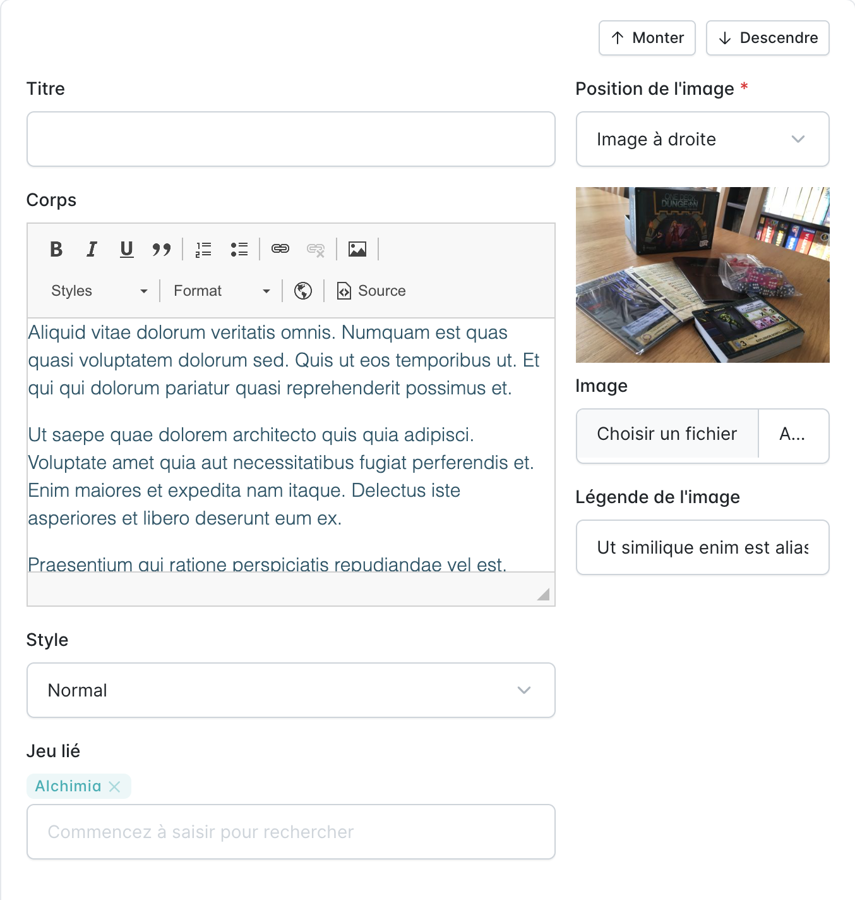
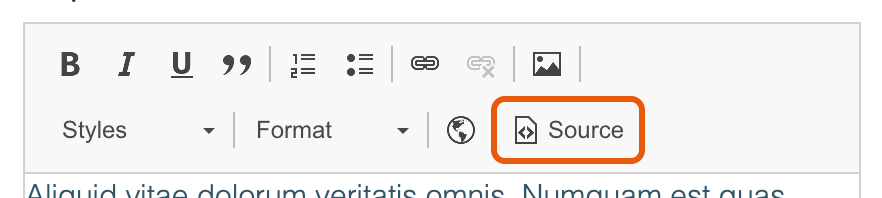

Un article est composé de blocs, dans l'onglet **Blocs** du formulaire de l'article. Chaque bloc a un titre, un corps, une image (avec sa position et sa légende), un style et, éventuellement, un jeu lié. Les boutons **Monter** et **Descendre** changent l'ordre des blocs.

## Lier un jeu à un bloc

Chaque bloc peut présenter un jeu, par exemple pour un article qui passe en revue plusieurs jeux (un bloc par lauréat d'un prix, par nouveauté d'un salon…).

Dans le champ **Jeu lié** du bloc, saisir au moins deux lettres du nom du jeu, puis le choisir dans la liste. Pour retirer le jeu, cliquer sur la croix à côté de son nom.



Sur la page de l'article, un bandeau discret s'affiche à la fin du bloc, sous son texte : le nom du jeu, le nombre de joueurs, l'âge, la durée et un lien « Voir la fiche » vers la page du jeu. Il ne reprend ni l'image ni la description du jeu, puisque le bloc présente déjà le jeu avec ses propres image et texte.

Le jeu lié à un bloc ne remplace pas le jeu de l'article, affiché dans la colonne de droite.

## Intégrer un contenu dynamique

:::tip
Pour présenter un jeu dans un bloc, préférer le champ **Jeu lié** ci-dessus. L'intégration à la main reste prise en charge, notamment pour les anciens articles.
:::

On peut intégrer un contenu dynamique, comme un jeu, dans le corps d'un bloc. Pour commencer, passer en mode source avec le bouton **Source** de l'éditeur.



### Intégrer un jeu

```html
<div class="entity" data-entity="game">{game-code}</div>
```

Remplacer `{game-code}` par le code du jeu, affiché dans la colonne **Code** de la liste des jeux.
