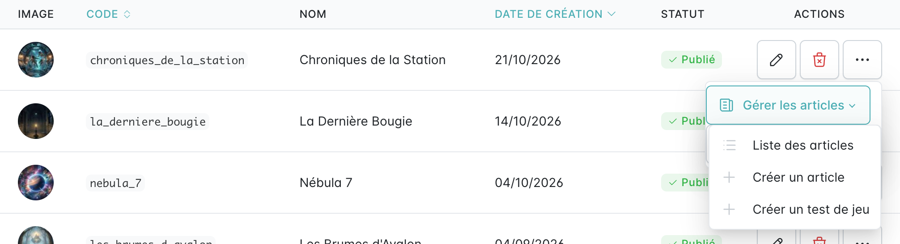
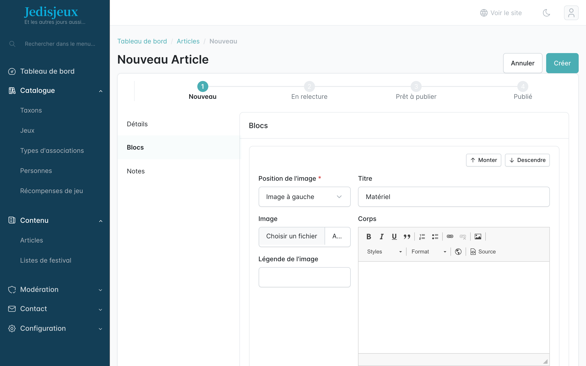

Pour rédiger un test de jeu, partir de la liste des jeux : ouvrir le menu **⋯** de la ligne du jeu, puis **Gérer les articles › Créer un test de jeu**.

Ainsi, l'article est relié au jeu et ses blocs génériques sont déjà créés : **Matériel**, **Règles**, **Durée de vie** et **Les conseils de jedisjeux**. Le titre est pré-rempli (« Critique de … ») et l'onglet **Notes** permet de noter le matériel, les règles et la durée de vie.

Le même sous-menu donne accès à la **liste des articles** du jeu et à la création d'un **article** simple déjà relié au jeu.
