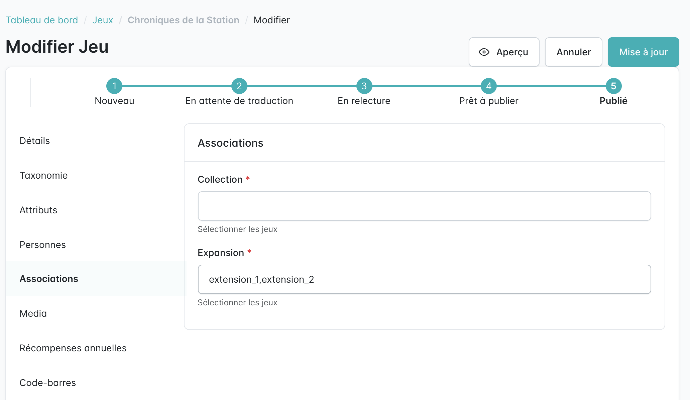

Les extensions sont des jeux à part entière (comme les jeux de la [même série](../same-collection/)). Une extension se crée donc comme un jeu classique.

Pour la relier, partir du jeu de base :

1. Modifier le jeu de base (icône crayon dans la liste des jeux).
2. Ouvrir l'onglet **Associations**.
3. Dans le champ **Expansion**, saisir les codes des extensions, séparés par des virgules (sans espace).
4. Cliquer sur **Mise à jour**.

