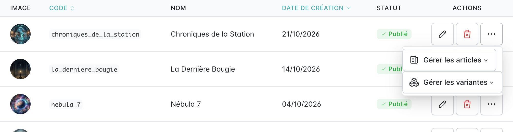

La ré-édition, c'est lorsque le jeu ressort dans une nouvelle édition. Elle se gère avec les variantes du jeu.

:::caution
Il ne faut pas créer un nouveau jeu, mais une nouvelle variante.
:::

Dans la liste des jeux, ouvrir le menu **⋯** de la ligne du jeu, puis **Gérer les variantes** :

- **Liste des variantes** affiche les éditions existantes ;
- **Ajouter** crée une nouvelle variante.

