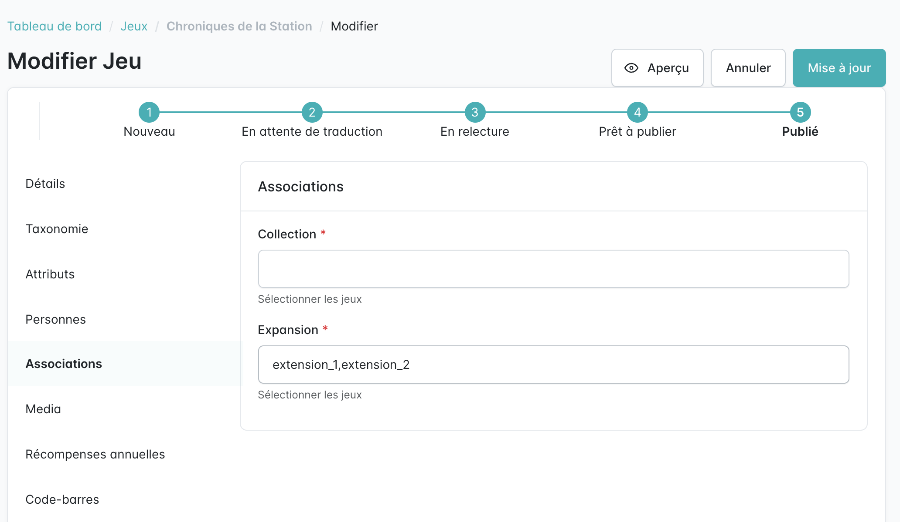

Certains jeux ne sont pas des ré-éditions mais ont un lien entre eux, comme les différents *Aventuriers du Rail*. Contrairement aux ré-éditions, un jeu de la même série se crée comme un jeu classique.

Pour le relier aux autres jeux de la série :

1. Modifier le jeu (icône crayon dans la liste des jeux).
2. Ouvrir l'onglet **Associations**.
3. Dans le champ **Collection**, saisir les codes des jeux de la série, séparés par des virgules (sans espace). Le code d'un jeu s'affiche dans la colonne **Code** de la liste des jeux.
4. Cliquer sur **Mise à jour**.

