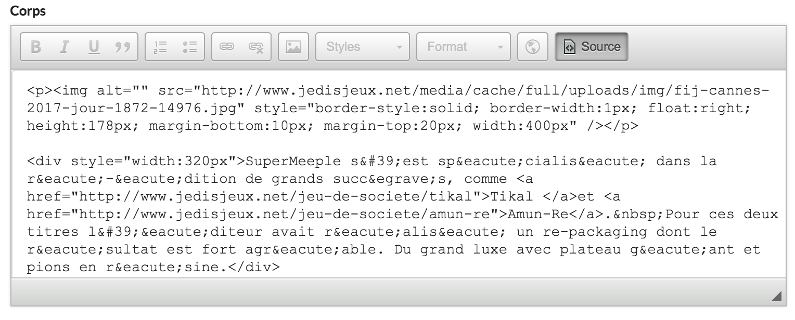

Blocs
=====

Lier un jeu à un bloc
---------------------

Chaque bloc peut présenter un jeu, par exemple pour un article qui passe en revue plusieurs jeux (un bloc par lauréat d'un prix, par nouveauté d'un salon…).

Dans l'onglet des blocs de l'article, saisir au moins deux lettres du nom du jeu dans le champ « Jeu lié », puis le choisir dans la liste. Pour retirer le jeu, cliquer sur la croix à côté de son nom.

Sur la page de l'article, un bandeau discret s'affiche à la fin du bloc, sous son texte : le nom du jeu, le nombre de joueurs, l'âge, la durée et un lien « Voir la fiche » vers la page du jeu. Il ne reprend ni l'image ni la description du jeu, puisque le bloc présente déjà le jeu avec ses propres image et texte.

Le jeu lié à un bloc ne remplace pas le jeu de l'article, affiché dans la colonne de droite.

Intégrer un contenu dynamique
-----------------------------

.. note::

   Pour présenter un jeu dans un bloc, préférer le champ « Jeu lié » ci-dessus. L'intégration à la main reste prise en charge, notamment pour les anciens articles.

On peut intégrer un contenu dynamique de différents types tels qu'un jeu. Pour commencer, passer en mode source dans l'éditeur.

Intégrer un jeu
~~~~~~~~~~~~~~~

.. code-block:: html

   
{game-code}

Remplacer ``{game-code}`` par le code du jeu que vous pouvez trouver dans la liste des jeux.
